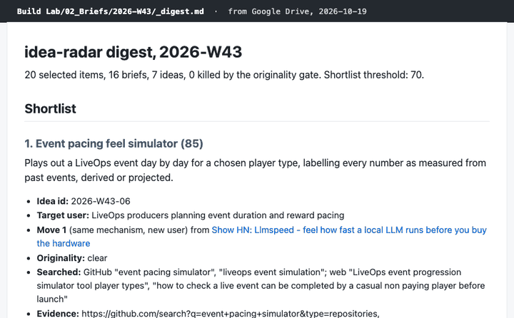

# idea-radar

Every Monday: what is gaining traction in developer and AI tools, turned into tool ideas for game and AI product teams.



<!-- GIF placeholder. Record it from the real digest of Monday 2026-10-19 before launch; audit check 8. -->

## Quickstart

You need Python 3.12 (what CI uses) and the GitHub CLI, logged in.

```bash
gh repo fork stonedhawk/idea-radar --clone && cd idea-radar
python3 -m venv .venv && .venv/bin/pip install -r requirements.txt
GITHUB_TOKEN=$(gh auth token) .venv/bin/python scripts/scan.py
```

That writes this week's scan to `data/scans/<week>.json` and adds GitHub star counts to `data/stars.csv`. `.venv/bin/python scripts/select.py --week <week>`, with the same token, then picks the 20 items the rest of the pipeline works on.

To run it every week, enable Actions on your fork (GitHub does not run workflows in a new fork until you do) and set up the weekly Claude task from [SPEC.md, Appendix A](SPEC.md#appendix-a-weekly-claude-task-prompt), pointed at your fork.

## How the stages work

1. **Collect** (GitHub Actions, Monday 01:30 UTC). [`scripts/scan.py`](scripts/scan.py) searches GitHub by the topics in [`config/sources.yaml`](config/sources.yaml), reads Show HN posts from the last 7 days through the Hacker News search API, and reads the Hugging Face Spaces trending list. GitHub traction is stars gained per 7 days, measured from a star snapshot 5 to 10 days old, or estimated from lifetime stars over age when there is none.
2. **Select** (same workflow). [`scripts/select.py`](scripts/select.py) drops forks, archived repos, repos with no README, lists and tutorials, the HF Space terms in the config, and anything picked in the previous two weeks, then fills 12 GitHub, 5 Show HN and 3 HF Space slots with at most 3 items per primary topic. The workflow commits both files.
3. **Brief, brainstorm, originality, score** (a weekly Claude task, Monday 03:15 UTC). The prompts in [`prompts/`](prompts) turn each item into the pattern underneath it, brainstorm ideas from it with four moves aimed at game producers, LiveOps teams, monetization designers and AI product managers, search GitHub and the web for anything that already does it, and score what survives against [`config/rubric.yaml`](config/rubric.yaml). Ideas scoring 70 or more make the shortlist, at most 3.
4. **Validate and render.** [`scripts/validate.py`](scripts/validate.py) checks every JSON file against [`schemas/`](schemas) and the rubric, recomputes every total, and [`scripts/render.py`](scripts/render.py) writes nothing unless validation passes. The task then copies the digest, briefs and backlog rows to Google Drive.
5. **Spec, audit, track** (on request). [`prompts/spec.md`](prompts/spec.md) turns a picked idea into a SPEC, a target README and a launch plan from [`templates/`](templates). Nothing ships until it passes the 11-check audit gate in SPEC section 11. [`scripts/track.py`](scripts/track.py) lists shipped ideas due a 7-day or 30-day star check.

## How it is checked

- `pytest` runs every test with the network blocked ([`tests/conftest.py`](tests/conftest.py)): velocity maths, every exclusion rule, quotas, the diversity cap, the two-week repeat rule, validation, rendering, star-check tracking, and a required-rules and length test for each of the five prompts.
- `python scripts/check_maths.py` checks velocity (both flags), score totals and lens caps against hand-worked examples, at least three per flag and area, each written out next to its inputs, and exits 1 on any mismatch.
- `python scripts/validate.py runs/<week>` gates every weekly run before anything reaches Drive.

## What leaves your machine

- **GitHub.** `scripts/scan.py` sends search queries built from your configured topics to `api.github.com`, with your `GITHUB_TOKEN` in the `Authorization` header. `scripts/select.py` asks the same API whether each candidate repo has a README.
- **Hacker News search (Algolia).** `scripts/scan.py` asks `hn.algolia.com` for Show HN posts from the last 7 days.
- **Hugging Face.** `scripts/scan.py` asks `huggingface.co` for the trending Spaces list.
- Every request above is a read and carries the User-Agent `idea-radar (+https://github.com/stonedhawk/idea-radar)`.
- **The scan workflow** ([`.github/workflows/scan.yml`](.github/workflows/scan.yml)) runs the same scripts in GitHub Actions with the built-in `GITHUB_TOKEN`, then commits and pushes `data/` to the repo. On a public fork, your scan files and star history are public.
- **The weekly Claude task** runs in your Claude account. It clones the repo, reads public READMEs, Show HN posts and the pages they link to, and Space pages, and runs GitHub and web searches, so that public source text and the ideas written from it are sent to Claude. It writes the digest, briefs, backlog rows and archive to your Google Drive through the Drive and Sheets connectors. No LLM API key is stored anywhere. If you are on a consumer Claude plan, whether those chats can be used to train models follows the privacy setting in your Claude account.
- `scripts/validate.py`, `scripts/render.py` and `scripts/track.py` only read and write local files.

## Limitations

- Velocity is estimated for the first two weeks of star history. A measured figure needs a snapshot of the same repo from 5 to 10 days earlier in `data/stars.csv`; until one exists, GitHub traction is lifetime stars over age, flagged `velocity_7d_estimated`.
- No Product Hunt. Its API needs an OAuth token, which this version does not store.
- The judgment steps need a Claude account that can run a scheduled task with Google Drive and Google Sheets connectors. Without one, you get the scan and the 20 selected items, not briefs, ideas or scores.
- GitHub search only finds repos tagged with one of the configured topics.
- `scripts/validate.py` checks shape, arithmetic, caps and copy rules, not whether a brief or a score is a good judgment.
- The prompts have not been graded across repeated runs. The tests check that each one states its rules and fits in 7,500 characters.

## Credits

Data comes from the GitHub REST API, the Hacker News search API by Algolia and the Hugging Face Hub API. Titles and descriptions in `data/scans/` are kept as their authors published them. No code was copied.

## License

MIT, Copyright (c) 2026 Rahul M Shah. See [LICENSE](LICENSE).
